<div align="center">


<br />

[](https://ahmed-portfolio-six-lovat.vercel.app/)
[](https://linkedin.com/in/ahmedmohamedalam)
[](mailto:ahmedalam4887482@gmail.com)
[](https://pub.dev/publishers/ahmedalam782/packages)
[](https://github.com/ahmedalam782)

</div>

---

### 🏛️ Executive Summary

> **Ahmed Mohamed Osman (Ahmed Alam)** is a **Mid-Level Flutter Developer** and **Open-Source Package Author** with **2+ years of production experience** engineering resilient cross-platform mobile ecosystems for Google Play and Apple App Store. 
> 
> Creator of **[`adaptive_video_player`](https://pub.dev/packages/adaptive_video_player)** (3.2k+ downloads · 160/160 pub points) and **[`osm_location_picker`](https://pub.dev/packages/osm_location_picker)** (683+ downloads · 160/160 pub points) — totaling **3.9k+ downloads** across pub.dev. Deeply specialized in **Clean Architecture**, reactive state management with **BLoC/Cubit**, **30% app load-time optimizations**, automated CI/CD deployment pipelines saving 5+ engineering hours per week, and rigorous **85% widget test coverage**.

---

### 💻 Developer Profile Matrix

```dart
class AhmedOsman extends FlutterDeveloper {
  final String alias        = "Ahmed Alam";
  final String location     = "Cairo, Egypt";
  final String degree       = "B.Sc. Computer Science — Benha University (Very Good)";
  final String currentRole  = "Flutter Developer @ MDSoft";
  final String portfolio    = "https://ahmed-portfolio-six-lovat.vercel.app/";

  final List<String> technicalPillars = [
    "Production Mobile Apps (7+ live products on Play Store & App Store)",
    "Clean Architecture · MVVM · Repository Pattern · SOLID · Dependency Injection",
    "Performance Optimization (30% startup acceleration via code splitting & lazy load)",
    "Open Source Author (pub.dev: adaptive_video_player & osm_location_picker)",
    "Automated CI/CD (GitHub Actions multi-flavor pipelines saving 5+ hrs/week)",
    "Test-Driven Reliability (85% automated widget & unit test coverage)",
  ];

  final Map<String, String> shippedProductionApps = {
    "Balsan": "E-Commerce & Smart Appliances (Google Play · App Store · Web)",
    "Silver Cosmetic": "Beauty & Cosmetics Marketplace (Google Play · App Store)",
    "Taxi Beirut": "Customer, Driver & Agent Ride-Hailing Suite (Google Play · App Store)",
    "VA Note Clinic": "Healthcare Records & Clinical EHR (Google Play · App Store · Web)",
    "Aman": "EdTech Student Attendance & Parent Circulars (Google Play · App Store)",
    "Tok Tok": "Tuk-Tuk Mobility Booking, Dispatch & Wallet (Google Play · App Store)",
    "Bait Al-Nakha": "Luxury Food Delivery Ordering Concept (Portfolio Showcase)",
  };

  final Map<String, String> openSourceLibraries = {
    "adaptive_video_player": "YouTube + Direct Video across 6 platforms (160/160 Pub Points)",
    "osm_location_picker": "Zero-API-key OpenStreetMap location selector for Flutter",
    "Fruit-Hub": "Clean Architecture Flutter e-commerce store with BLoC",
    "elevate_online_exam": "Online examination platform with strict Clean Architecture",
    "elevate_tracking_app": "Real-time courier GPS tracking with Google Maps",
    "Markaz-ElAmal-APP": "Rehabilitation & clinical appointment scheduling mobile app",
  };

  String get mission => "Architecting mission-critical, buttery-smooth mobile applications "
                        "with uncompromised modularity and elegant user experience.";

  bool get availableForWork => true; // Open to Global Remote Contracts & Full-Time Roles
}
```

---

### 📊 Verified Impact & Benchmarks

| Milestone / Metric | Production Verification | Impact Scope |
|:---|:---|:---|
| 🚀 **7+ Production Mobile Apps** | Published & maintained on Google Play & Apple App Store | E-commerce, Ride-Hailing, Healthcare EHR, Logistics |
| ⚡ **-30% Startup Latency** | Optimized code-splitting, lazy imports & asset preloading | Balsan E-Commerce Production App |
| 📦 **160 / 160 Pub Points** | Verified open-source package scoring on pub.dev | Author: `adaptive_video_player` & `osm_location_picker` |
| ⚙️ **5+ Hours / Week Saved** | Automated GitHub Actions CI/CD build & release workflows | MDSoft Multi-App Delivery Flow |
| 🧪 **85% UI Test Coverage** | Automated widget testing suite for regression prevention | Elevate Tech Remote Department |
| 🎓 **B.Sc. in Computer Science** | Benha University Faculty of Science (Grade: Very Good) | Graduation Project: Grade Excellent |

---

### 📦 Open Source Packages

<div align="center">
  
</div>

<br />

#### 🎥 [adaptive_video_player](https://pub.dev/packages/adaptive_video_player) `v1.3.3`
[](https://pub.dev/packages/adaptive_video_player)
[](https://pub.dev/packages/adaptive_video_player/score)
[](https://pub.dev/packages/adaptive_video_player)

> The unified video player for Flutter supporting **YouTube + direct streaming (MP4, MKV, WebM, HLS / M3U8)** across **all 6 Flutter platforms** (Android, iOS, Web, macOS, Windows, Linux) through a single declarative API.

- 🔀 **Smart Auto-Detection** — Resolves YouTube streams vs direct URLs automatically.
- 📺 **Rich YouTube Controls** — Native playback controls on Web & Desktop, live stream viewer counters, forced HD.
- 🎞️ **Direct Video Stream** — Quality selector, external SRT/VTT subtitle overlays, cached byte memory support.
- 📱 **Full Cross-Platform** — Consistent behavior across mobile, desktop, and modern browsers.

```dart
AdaptiveVideoPlayer(
  config: VideoConfig(
    videoUrl: 'https://youtu.be/dQw4w9WgXcQ', // or direct .mp4 / .m3u8 stream
    autoPlay: true,
  ),
)
```

[View on pub.dev](https://pub.dev/packages/adaptive_video_player) · [GitHub Repository](https://github.com/ahmedalam782/vidoes_player)

---

#### 🗺️ [osm_location_picker](https://pub.dev/packages/osm_location_picker) `v1.0.5`
[](https://pub.dev/packages/osm_location_picker)
[](https://pub.dev/packages/osm_location_picker/score)
[](https://pub.dev/packages/osm_location_picker)

> **Zero API keys. Zero billing. Zero external setup.** Complete location-picking Flutter component powered by OpenStreetMap and Nominatim reverse geocoding.

- 🗺️ Interactive map layer built on `flutter_map` with fluid panning and pinch-to-zoom.
- 🔍 Instant address geocoding, reverse search, and one-tap GPS current location targeting.
- 🎨 Themeable UI via `LocationPickerTheme` with out-of-the-box Arabic and English localization.
- 🏗️ Isolated BLoC state management ensuring zero global application scope leakage.

```dart
final LocationModel? result = await Navigator.of(context).push<LocationModel>(
  MaterialPageRoute(builder: (_) => const LocationPickerView()),
);

print(result?.address);           // Reverse-geocoded address
print(result?.latLng?.latitude);  // Geo coordinates
```

[View on pub.dev](https://pub.dev/packages/osm_location_picker) · [GitHub Repository](https://github.com/ahmedalam782/osm_location_picker)

---

<div align="center">
  
</div>

<br />

### 🚀 Production Applications Master Directory

The following matrix provides an executive overview of all 7 published production applications engineered and maintained in production:

| # | Application | Domain | Architecture & Technologies | Live Releases | Key Milestone / Impact |
|:---:|:---|:---|:---|:---|:---|
| **01** | **Balsan** | E-Commerce & Appliances | Clean Architecture · MVVM · BLoC · GetIt · Google Maps | [](https://play.google.com/store/apps/details?id=com.mdsoft.balsan2) [](https://apps.apple.com/eg/app/al-balsan/id6747080711) [](https://www.al-balsan.com) | **-30% Startup Latency** via code splitting |
| **02** | **Silver Cosmetic** | Beauty & Cosmetics Retail | Clean Architecture · BLoC/Cubit · REST · Cached Images | [](https://play.google.com/store/apps/details?id=com.mdsoft.silver) [](https://apps.apple.com/eg/app/%D9%83%D9%88%D8%B2%D9%85%D8%AA%D9%83-%D9%81%D8%B6%D8%A9/id6746095779) | Categorized catalog with dual AR/EN RTL support |
| **03** | **Taxi Beirut** | Ride-Hailing & FinTech Suite | Clean Architecture · BLoC · Maps Geofencing · VOIP | [](https://play.google.com/store/apps/details?id=com.taxi.md_soft.taxi_customer_app) [](https://apps.apple.com/eg/app/%D8%AA%D9%83%D8%B3%D9%8A-%D8%A8%D9%8A%D8%B1%D9%88%D8%AA/id6748995437)<br />[](https://play.google.com/store/apps/details?id=com.mdsoft.taxiBeirutsDriver) [](https://apps.apple.com/us/app/%D8%AA%D9%83%D8%B3%D9%8A-%D8%A8%D9%8A%D8%B1%D9%88%D8%AA-%D8%A7%D9%84%D8%B3%D8%A7%D8%A6%D9%82/id6759983693)<br />[](https://play.google.com/store/apps/details?id=com.mdsoft.taxibeirutagent) [](https://apps.apple.com/eg/app/taxi-beirut-agent/id6760011080) | Live GPS telemetry & QR wallet top-ups |
| **04** | **VA Note Clinic** | Healthcare & Clinical EHR | Clean Architecture · MVVM · Cloud Firestore · FCM | [](https://play.google.com/store/apps/details?id=com.mdsoft.vanotesclinic) [](https://apps.apple.com/us/app/va-note/id6759074915) [](https://va-note.com/clinic/) | Chronological visit EHR & auto appointment reminders |
| **05** | **Aman (أمان)** | EdTech Student Attendance | Clean Architecture · BLoC · FCM Notifications | [](https://play.google.com/store/apps/details?id=com.mdsoft.timmy_attend_family) [](https://apps.apple.com/eg/app/%D8%A3%D9%85%D8%A7%D9%86-aman/id6749891970) | Multi-child timeline & instant arrival alerts |
| **06** | **Tok Tok** | Tuk-Tuk Mobility & Wallet | Clean Architecture · BLoC · Live Driver Dispatch | [](https://play.google.com/store/apps/details?id=com.mdsoft.tok_tok_taxi_user) [](https://apps.apple.com/om/app/id6749179422)<br />[](https://play.google.com/store/apps/details?id=com.mdsoft.tok_tok_taxi_drivers) [](https://apps.apple.com/om/app/id6749203906)<br />[](https://play.google.com/store/apps/details?id=com.mdsoft.tok_tok_taxi_agent) [](https://apps.apple.com/om/app/id6749199890) | Real-time bidding, trip dispatch & agent wallet |
| **07** | **Bait Al-Nakha** | Gourmet Food Delivery | Clean Architecture · Gamified UI/UX Design | [](https://ahmed-portfolio-six-lovat.vercel.app/) | Interactive customer testing prototype |

---

### 📱 Featured Applications Showcase & Technical Architecture

#### 🛒 1. Balsan — E-Commerce & Smart Appliance Marketplace

<div align="center">
  
  <br /><br />
  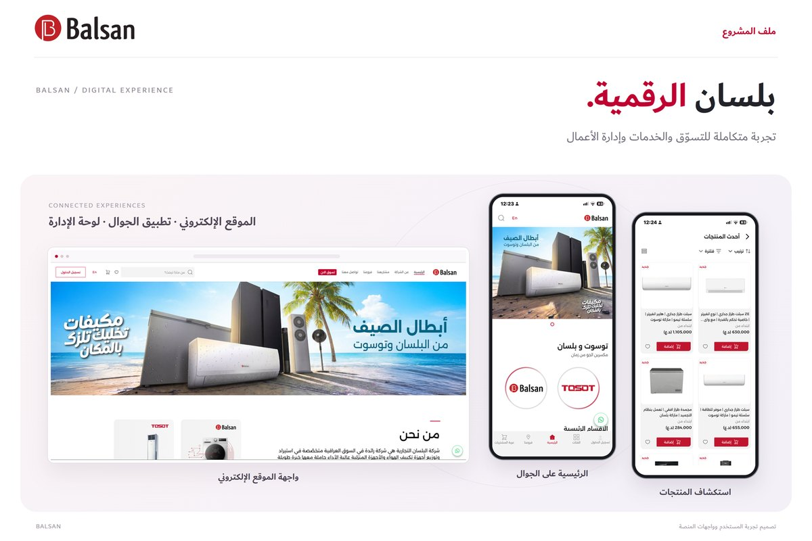
</div>

> Comprehensive e-commerce mobile product for air conditioning and home appliances across the Middle East, featuring live catalog browsing, multi-gateway checkout, and live order tracking.

- 🏗️ **Architecture & Logic:** Clean Architecture, MVVM, BLoC/Cubit, GetIt Dependency Injection.
- ⚡ **Performance Optimization:** Cut cold-startup latency by **30%** through route-level code splitting and deferred asset loads.
- 📍 **Features:** Google Maps store locator, real-time shipment dispatch, FCM push alerts, and offline caching.
- 📱 **Store Links:** 
  [](https://play.google.com/store/apps/details?id=com.mdsoft.balsan2)
  [](https://apps.apple.com/eg/app/al-balsan/id6747080711)
  [](https://www.al-balsan.com)

---

#### 💄 2. Silver Cosmetic (كوزمتك فضة) — Beauty & Cosmetics Platform

<div align="center">
  
  <br /><br />
  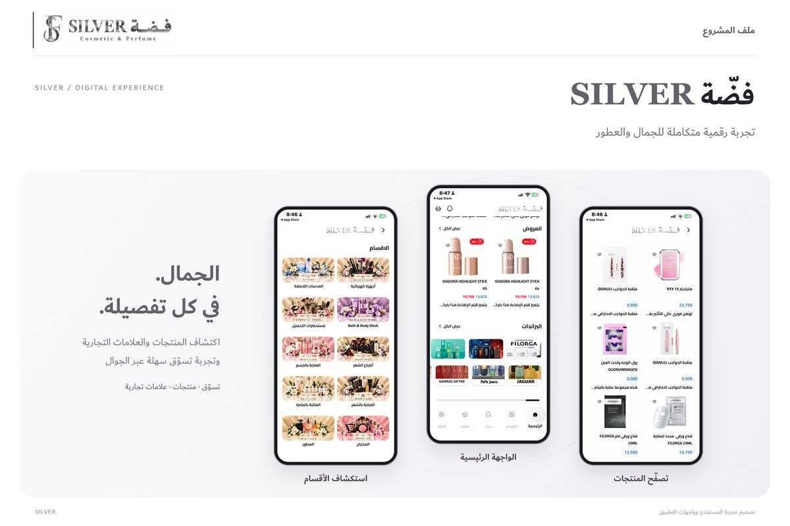
</div>

> Premium cosmetics and skincare digital storefront with categorized catalog exploration, promotional vouchers, wishlist synchronization, and multi-currency checkout.

- 🏗️ **Architecture:** Clean Architecture + BLoC/Cubit + REST API + Memory-Efficient Cached Image Layer.
- 🌐 **Features:** Dynamic brand filtering, discount vouchers, inventory alerts, and bilingual (Arabic & English) RTL/LTR localization.
- 📱 **Store Links:**
  [](https://play.google.com/store/apps/details?id=com.mdsoft.silver)
  [](https://apps.apple.com/eg/app/%D9%83%D9%88%D8%B2%D9%85%D8%AA%D9%83-%D9%81%D8%B6%D8%A9/id6746095779)

---

#### 🚕 3. Taxi Beirut — Multi-Tier Ride-Hailing, Dispatch & Agent Ecosystem

<div align="center">
  
  <br /><br />
  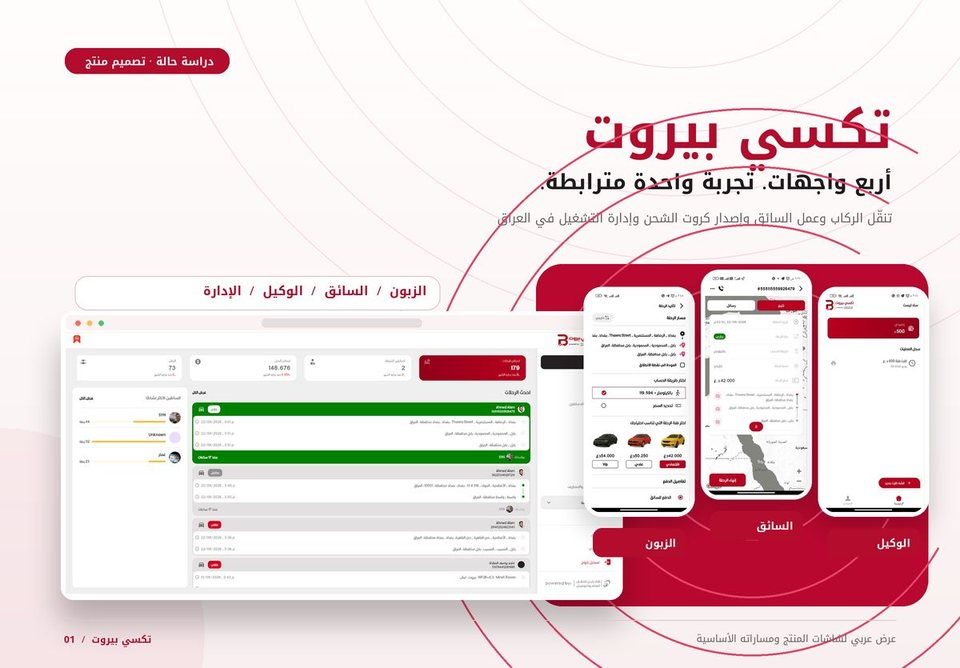
</div>

> Complete tripartite ride-hailing suite spanning **Customer**, **Driver**, and **Agent** apps with live GPS tracking, automated fare matrix calculation, VOIP alerts, and QR wallet top-ups.

- 🏗️ **Architecture:** Clean Architecture + BLoC/Cubit + Google Maps Geofencing + REST API + WebSockets.
- ⚡ **Capabilities:** Sub-second driver telemetry, VOIP incoming trip ringers, driver KYC onboarding, agent balance deposits, and offline-resilient trip state machine.
- 📱 **Applications Suite:**
  - **Customer App:** [](https://play.google.com/store/apps/details?id=com.taxi.md_soft.taxi_customer_app) [](https://apps.apple.com/eg/app/%D8%AA%D9%83%D8%B3%D9%8A-%D8%A8%D9%8A%D8%B1%D9%88%D8%AA/id6748995437)
  - **Driver App:** [](https://play.google.com/store/apps/details?id=com.mdsoft.taxiBeirutsDriver) [](https://apps.apple.com/us/app/%D8%AA%D9%83%D8%B3%D9%8A-%D8%A8%D9%8A%D8%B1%D9%88%D8%AA-%D8%A7%D9%84%D8%B3%D8%A7%D8%A6%D9%82/id6759983693)
  - **Agent App:** [](https://play.google.com/store/apps/details?id=com.mdsoft.taxibeirutagent) [](https://apps.apple.com/eg/app/taxi-beirut-agent/id6760011080)

---

#### 🏥 4. VA Note Clinic — Healthcare Records & Clinical Workflow

<div align="center">
  
  <br /><br />
  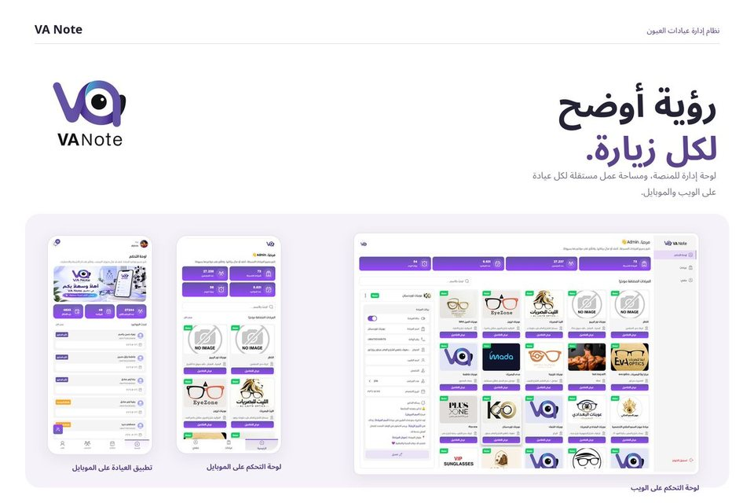
</div>

> Medical record and clinical management application for healthcare practitioners, providing chronological visit history, diagnostic notes, and automated patient appointment reminders.

- 🏗️ **Architecture:** Clean Architecture + MVVM + Cloud Firestore + Firebase Auth.
- 🩺 **Features:** Encrypted patient records, diagnostic history, role-based practitioner controls, and FCM appointment notifications.
- 📱 **Store Links:**
  [](https://play.google.com/store/apps/details?id=com.mdsoft.vanotesclinic)
  [](https://apps.apple.com/us/app/va-note/id6759074915)
  [](https://va-note.com/clinic/)

---

#### 🏫 5. Aman (أمان) — School Attendance & Parent Notification System

<div align="center">
  
  <br /><br />
  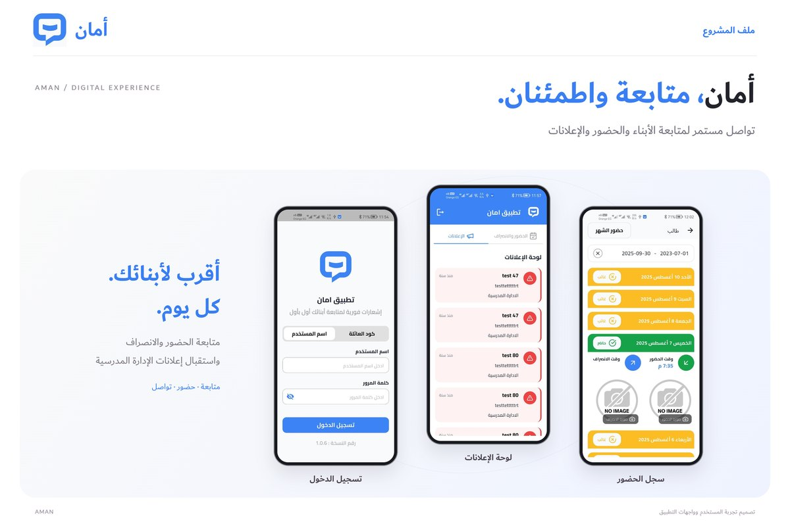
</div>

> Dedicated parent portal for real-time monitoring of student arrival, departure, bus transit status, and official school circulars.

- 👨‍👩‍👧 **Features:** Family code authentication, multi-child timeline monitoring, real-time arrival timestamps, and institutional announcements.
- 📱 **Store Links:**
  [](https://play.google.com/store/apps/details?id=com.mdsoft.timmy_attend_family)
  [](https://apps.apple.com/eg/app/%D8%A3%D9%85%D8%A7%D9%86-aman/id6749891970)

---

#### 🛺 6. Tok Tok — Tuk-Tuk Dispatch, On-Demand Booking & Wallet

<div align="center">
  
  <br /><br />
  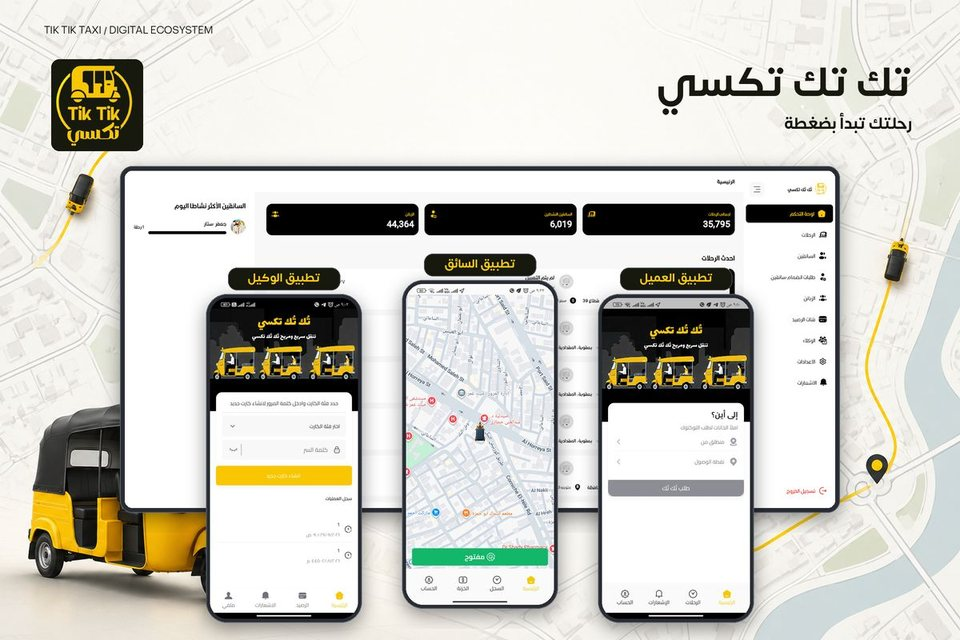
</div>

> Specialized micro-mobility ride dispatch application built for localized three-wheeler transport networks across Customer, Driver, and Station Agent workflows.

- 📍 **Features:** Geo-fenced trip dispatch, real-time trip bidding, in-app agent balance top-ups, and post-ride rating matrix.
- 📱 **Applications Suite:**
  - **Customer App:** [](https://play.google.com/store/apps/details?id=com.mdsoft.tok_tok_taxi_user) [](https://apps.apple.com/om/app/id6749179422)
  - **Driver App:** [](https://play.google.com/store/apps/details?id=com.mdsoft.tok_tok_taxi_drivers) [](https://apps.apple.com/om/app/id6749203906)
  - **Agent App:** [](https://play.google.com/store/apps/details?id=com.mdsoft.tok_tok_taxi_agent) [](https://apps.apple.com/om/app/id6749199890)

---

#### 🍽️ 7. Bait Al-Nakha (بيت النكهة) — Luxury Food Delivery Concept

<div align="center">
  
  <br /><br />
  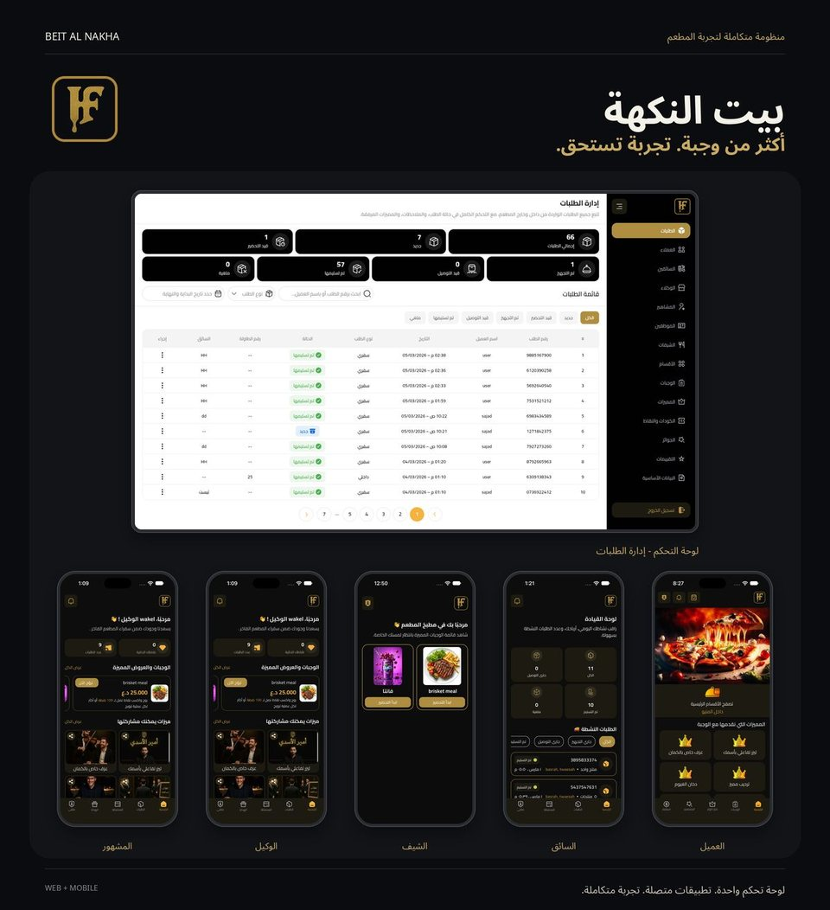
</div>

> High-end gastronomic ordering prototype designed for Baghdad with a gamified culinary experience, personalized packaging engraving options, and multi-actor order tracking.

- 🎨 **Role:** Mobile Lead & UI/UX Design Specialist.
- ✨ **Key Concept:** Curated culinary menus, chef dispatch pipelines, VIP points system, and customized laser-engraved greeting tags.
- 🔗 **View Design:** [](https://ahmed-portfolio-six-lovat.vercel.app/)

---

### 💼 Verified Professional Experience

```
💼 Flutter Developer @ MDSoft (Jan 2025 – Present | Full-Time | Egypt)
  • Architected & maintained 7+ production Flutter applications on Google Play & Apple App Store.
  • Accelerated Balsan startup load time by 30% via route-based code splitting and lazy component init.
  • Integrated real-time GPS telemetry, Google Maps SDK, VOIP notifications, and QR wallet deposits for Taxi Beirut.
  • Authored and published adaptive_video_player (3.2k+ downloads, 160/160 pub points, 19 likes) across 6 Flutter platforms.
  • Established automated GitHub Actions CI/CD pipelines, eliminating 5+ hours of manual build and release tasks weekly.

🎓 Flutter Developer (Part-Time) @ Elevate Tech (Oct 2025 – Mar 2026 | Remote)
  • Engineered mission-critical features remotely within the departmental mobile engineering team.
  • Automated Flutter widget testing suite covering 85% of critical UI paths, elevating deployment stability.
  • Enforced strict Clean Architecture, BLoC pattern, Repository abstraction, Dependency Injection (GetIt), and SOLID.

💻 Microsoft Dynamics RMS IT Specialist @ Total Stores (Jun 2022 – Aug 2023 | Full-Time | Egypt)
  • Built automated follow-up notification workflows in RMS, saving 10+ operational hours per week.
  • Formulated analytical inventory reporting models that directly steered purchasing and inventory turnover.
```

---

### 📜 Verified Credentials & Education

- 🏆 **Official Experience Certificate (Flutter Developer)** — Elevate Tech Department *(Issued Jun 2026)*
- 🎓 **Flutter Advanced Bootcamp Training Program** — Elevate Tech *(Issued Jun 2026)*
- 🎖️ **AMIT Flutter Diploma** — 125-Hour Intensive Specialized Track | **Grade: 99% Distinction** *(Jan 2024)*
- 📜 **Route IT Center Flutter Development Diploma** *(Sep 2024)*
- 🧭 **Introduction to Agile Development & Scrum** — IBM & Coursera *(Sep 2026)*
- 🔬 **Data Structures & Algorithms Specialization** — UC San Diego & Coursera *(Apr 2020)*
- 🎓 **B.Sc. in Computer Science** — Benha University, Faculty of Science | **Grade: Very Good** *(Sep 2020)*

---

### 🛠️ Technical Competency Matrix

<div align="center">
  
</div>

<br />

<table>
  <tr>
    <td width="25%" valign="top"><strong>📱 Mobile &amp; Core</strong></td>
    <td width="75%">
      <code>Flutter</code> &bull; <code>Dart</code> &bull; <code>C#</code> &bull; <code>Clean Architecture</code> &bull; <code>MVVM</code> &bull; <code>BLoC / Cubit</code> &bull; <code>Repository Pattern</code> &bull; <code>Dependency Injection (GetIt)</code> &bull; <code>OOP / SOLID</code>
    </td>
  </tr>
  <tr>
    <td width="25%" valign="top"><strong>🌐 Backend &amp; Cloud</strong></td>
    <td width="75%">
      <code>Firebase (Firestore, FCM, Auth)</code> &bull; <code>RESTful APIs (Dio / Retrofit)</code> &bull; <code>WebSockets</code> &bull; <code>Google Maps SDK</code> &bull; <code>OpenStreetMap / Nominatim</code> &bull; <code>Offline Caching (Hive / SharedPrefs)</code>
    </td>
  </tr>
  <tr>
    <td width="25%" valign="top"><strong>⚙️ DevOps &amp; Quality</strong></td>
    <td width="75%">
      <code>GitHub Actions (CI/CD)</code> &bull; <code>Widget &amp; Unit Testing (85% Coverage)</code> &bull; <code>Google Play Console</code> &bull; <code>Apple App Store Connect</code> &bull; <code>Git / GitHub Flow</code> &bull; <code>Postman</code> &bull; <code>Figma</code>
    </td>
  </tr>
</table>

---

### 📈 GitHub Contribution Activity & Engineering Stats

<div align="center">

<a href="https://github.com/ahmedalam782">
  
</a>

<br /><br />

<a href="https://github.com/ahmedalam782">
  
</a>
<a href="https://github.com/ahmedalam782">
  
</a>

</div>

---

### 🤝 Professional Inquiries & Collaboration

<div align="center">

[](https://ahmed-portfolio-six-lovat.vercel.app/)
[](https://linkedin.com/in/ahmedmohamedalam)
[](mailto:ahmedalam4887482@gmail.com)
[](https://pub.dev/publishers/ahmedalam782/packages)
[](https://github.com/ahmedalam782)

</div>

<br />

<div align="center">


</div>
